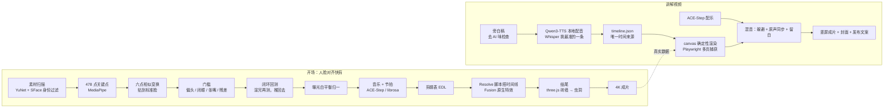

# Face-Aligned Montage · 人脸对齐快剪工具链

> 两百多张脸，眼睛没挪过地方。

把几百段自拍视频和照片里的同一张脸，按音乐节拍快切，五官（眼睛、鼻尖、嘴角、下巴）始终钉在画面同一个位置。剪辑在 DaVinci Resolve 里由脚本搭建，结尾是砖墙碎裂、留白、粒子重聚、虫洞穿越和中英文标题。

仓库里还有第二条流水线：用一个确定性的 canvas 渲染器，加本地语音和音乐模型，做一条 4 分钟的竖屏"幕后讲解"视频，讲清楚上面这条开场是怎么做出来的。

**这里只有代码、教程、分析和提示词。** 不含任何人脸、视频、照片、配音、配乐或素材清单。你需要用自己的素材跑。

[English summary](#english-summary)

## 做出来是什么样

| 指标 | 数值 |
|---|---|
| 成片 | 4K 16:9，60 fps，33.8 秒 |
| 原始素材 | 88 段视频 + 254 张照片 |
| 过了全部门槛的素材 | 40 个 |
| 剪切数 | 202 刀（另有 28 个画中画层） |
| 眼睛位置偏差 | 4K 画面中位数 12 到 18 像素 |
| 时间线 | 232 个片段，9 条视频轨，全部脚本生成 |
| 讲解视频 | 1080×1920，30 fps，4 分 23 秒，-16 LUFS |

## 两条流水线



## 快速开始

```bash
git clone https://github.com/syydaniel/face-aligned-montage
cd face-aligned-montage
python3 -m venv .venv && source .venv/bin/activate
pip install -r requirements.txt
bash scripts/download_models.sh            # YuNet, SFace, MediaPipe FaceLandmarker 到 $MONTAGE_ROOT/work/models
cp config.example.env .env && $EDITOR .env  # 填好下面这些路径
```

| 环境变量 | 含义 |
|---|---|
| `MONTAGE_ROOT` | 开场流水线的工作目录，里面会生成 `work/`、`assets/`、`cache/`、`out/` |
| `MONTAGE_SOURCES_CSV` | 素材清单 CSV，列：`cid,path,dur,date,verdict`，`verdict` 为 `是我` 的行会被扫描 |
| `MONTAGE_PHOTOS` | 照片文件夹（JPG） |
| `MONTAGE_REF_FACE` | 一张清晰的正脸照，用于只保留这个人（身份过滤） |
| `MONTAGE_OUT` / `MONTAGE_FINAL` | 成片输出目录 / 成片文件 |
| `EXPLAINER_ROOT` | 讲解视频的工作目录 |
| `VOICE_DIR` / `VOICE` | 克隆音色的参考音频和文本（`<VOICE>.wav` + `<VOICE>.txt`） |
| `EXPLAINER_BED` | 讲解视频的配乐文件 |
| `ACESTEP_DIR` | ACE-Step 1.5 的安装目录 |

完整步骤见 [docs/02_教程_人脸对齐快剪.md](docs/02_教程_人脸对齐快剪.md) 和 [docs/03_教程_讲解视频.md](docs/03_教程_讲解视频.md)。

## 文档

| 文档 | 内容 |
|---|---|
| [01 技术栈](docs/01_技术栈.md) | 每个组件是什么、为什么选它、替代方案 |
| [02 教程：人脸对齐快剪](docs/02_教程_人脸对齐快剪.md) | 从素材到 4K 成片，逐步命令和参数 |
| [03 教程：讲解视频](docs/03_教程_讲解视频.md) | 从旁白稿到竖屏成片、封面和发布文案 |
| [04 分析与复盘](docs/04_分析与复盘.md) | 设计取舍、数字、失败和修复 |
| [05 DaVinci Resolve 脚本踩坑](docs/05_达芬奇脚本踩坑.md) | 坐标、裁切、旋转、渲染限制，全部实测 |
| [06 提示词](docs/06_提示词.md) | 音乐、配音、文案、给 AI 助手的需求简报 |
| [07 合规与隐私](docs/07_合规与隐私.md) | 平台 AI 规则、身份过滤、仓库里排除了什么 |

## Claude Code 插件：skill + agent

仓库本身是一个 Claude Code 插件市场，带两个 skill 和两个 agent：

| 名称 | 类型 | 用途 |
|---|---|---|
| `face-aligned-montage` | skill | 按本仓库流水线做人脸对齐快剪，含门槛、闭环、Resolve 规则 |
| `making-of-explainer` | skill | 做竖屏幕后讲解视频：文案去 AI 味、配音、canvas 场景、混音、合规 |
| `montage-director` | agent | 委派整条开场的制作或修改 |
| `explainer-director` | agent | 委派整条讲解视频的制作 |

```text
/plugin marketplace add syydaniel/face-aligned-montage
/plugin install face-aligned-montage@face-aligned-montage
```

## 目录

```text
pipeline/              开场流水线（00 到 14 按顺序跑）
  resolve/             在 Resolve 里执行的脚本：build / fx / fx3d / final / sapphire
  three/               three.js 砖墙→隧道场景、逐帧捕获服务器、音频转节拍
  music/               ACE-Step 批量生成脚本和配乐提示词
explainer/             讲解视频流水线
  web/index.html       20 个场景的 canvas 渲染器
  vo/                  旁白稿和 TTS
  tools/ai_flavor.py   中文文案 AI 味检查
skills/ agents/        Claude Code skill 和 agent
docs/                  教程、分析、提示词、合规
```

## 隐私

- 仓库不含任何媒体文件和由素材生成的数据（关键点、剪辑表、素材清单都不在）。
- 所有个人路径都换成了环境变量。
- `.gitignore` 默认挡住 `work/ assets/ cache/ out/ data/ frames/` 和常见媒体格式，防止误提交。
- 身份过滤会丢掉同框有其他人脸的照片，避免别人出现在成片里。

## 致谢

MediaPipe Face Landmarker、OpenCV YuNet / SFace、BiRefNet（经 rembg）、ACE-Step 1.5、Qwen3-TTS（mlx-audio）、Whisper large-v3-turbo（mlx-whisper）、librosa、three.js、Playwright、DaVinci Resolve Studio 脚本 API。

工程由作者主导，和 Claude Code 协作完成：创作判断和取舍是作者做的，AI 负责写代码、算数据、跑渲染。

## License

MIT

---

## English summary

A toolkit for a beat-synced montage in which hundreds of selfie clips and photos of one person are cut on the beat while the eyes, nose, mouth corners and chin stay pinned to the same screen position. The edit is assembled in DaVinci Resolve by script (232 clips, 9 video tracks, Fusion-native effects). The ending is a three.js brick wall that breaks, rests, reassembles into a tunnel and dives into a bilingual title.

The second pipeline renders a 4-minute vertical making-of video with a deterministic canvas renderer captured by Playwright, local TTS (Qwen3-TTS via mlx-audio, Whisper-scored takes) and local music (ACE-Step 1.5).

Key techniques: MediaPipe 478-point landmarks, a 6-point Umeyama similarity fit to one canonical face, pose/blink/jaw/residual gates, closed-loop re-measurement after warping, per-face exposure and white-balance gains, beat-grid subdivision (8ths → 16ths → 32nds), single-feature picture-in-picture, split-face collage, matte-over-bars "naked-eye 3D", and a deliberate silent pause before the tunnel.

No media, faces, voice or source lists are included. Bring your own footage. See `docs/` (Chinese) for the full tutorial, the Resolve scripting pitfalls, the prompts and the analysis. Installable as a Claude Code plugin with two skills and two agents.
