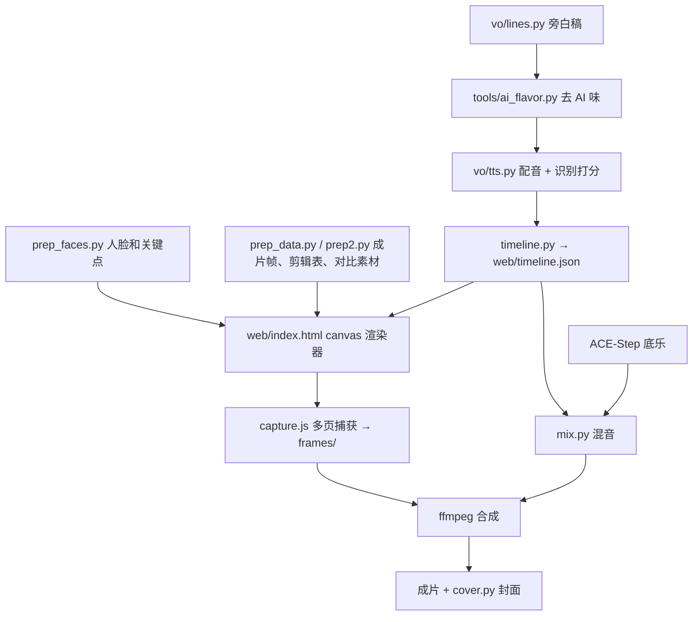

# 03 教程：幕后讲解视频

目标：一条 3 到 5 分钟的竖屏视频（1080×1920，30 fps），第一人称讲开场是怎么做的，片尾放完整版。要求有高级感、有活人味，前 5 秒留得住人，结尾有自然的互动。

所有文件在 `explainer/`，工作目录是 `EXPLAINER_ROOT`，最简单是直接设成仓库里的 `explainer/` 文件夹（生成的 `data/`、`frames/`、`out/` 都在 `.gitignore` 里）。它会读开场流水线的数据（`MONTAGE_ROOT`）和成片（`MONTAGE_FINAL`）。

## 结构



## 第 1 步：写旁白稿

`vo/lines.py` 是一个有序字典：`key -> (场景, 文本)`。场景名对应 `web/index.html` 里的 `SC.<场景>` 函数。

写稿规则（详见 06）：

- 第一句就给结果和反差，第三句告诉观众完整版在片尾。
- 一句只讲一件事，口语，短句，有具体数字。
- 讲真实发生的翻车，讲当时怎么想的。
- 结尾问一个二选一的问题，再说下期讲什么。

写完跑检查，目标是 0 标记：

```bash
python explainer/tools/ai_flavor.py explainer/vo/lines.py
```

## 第 2 步：配音

```bash
VOICE=my_voice VOICE_DIR=/path/to/voices python explainer/vo/tts.py
```

- `VOICE_DIR` 里放 `<VOICE>.wav`（10 到 20 秒干净的参考音）和 `<VOICE>.txt`（这段音频的文字）。
- 每句最多生成三次，用 Whisper 识别后和原文比相似度。识别结果里的阿拉伯数字先转成汉字，"两"统一成"二"，否则"三十三"和"33"会被误判。
- 同音字（剪/捡、帧/针）在识别里分不出来，只要听感对就行。
- 输出 `vo/<VOICE>/choice.json`：每句选中的文件、时长、准确率、逐字时间戳。

## 第 3 步：配乐

```bash
ACESTEP_GENERATION_TIMEOUT=3600 ACESTEP_DIR=~/ACE-Step-1.5 ~/ACE-Step-1.5/.venv/bin/python pipeline/music/ace_run.py explainer/music/jobs_bed.json
```

230 秒的长曲在默认 600 秒超时内跑不完，一定要设 `ACESTEP_GENERATION_TIMEOUT`。生成两版后用 librosa 看节奏和每 10 秒的能量曲线，选更平稳、更贴近目标 BPM 的那版。用 Whisper 识别一下：只出现"字幕志愿者"这类幻觉文字，说明是纯音乐，没有人声。

## 第 4 步：准备画面数据

```bash
python explainer/prep_faces.py     # AI 环境：16 张可用脸、真实淘汰例（偏头/闭眼/张嘴）、478 点网格和三角剖分
python explainer/prep_data.py      # 成片帧、剪辑表、曝光对比、3D 分层、砖块图集、翻车真实帧
python explainer/prep2.py          # 4K 中心方形裁切帧、历史版本缩略图、素材图集
```

要点：

- 源素材多是 10 bit。ffmpeg 输出 PNG 时要强制 `-pix_fmt rgb24`，否则得到 16 bit 图，写 JPG 时会被截断成一片白。
- 标准脸的 `mouthR` 在画面右侧，对应 MediaPipe 的 291 号点，和眼睛的命名方向相反。弄反了拟合残差会到 45 像素。
- 方形帧取 4K 画面中间的 2160×2160。开场的脸永远在正中，所以方形裁切天然好看。

## 第 5 步：时间线

```bash
python explainer/timeline.py
```

`web/timeline.json` 是唯一的时间来源，渲染器和混音都读它：

- 每句旁白的起止时间。句间 0.3 秒，场景之间再加场景尾巴和 0.45 秒。
- 特定句子后面的额外停顿。"故意停了一下"那句后面留 1.5 秒真空。
- 场景起止、章节名、完整版播放的起止。
- 字幕短句：按标点切，短于 5 个字的并到下一句，按字数和标点权重分配时间。

## 第 6 步：渲染器

`web/index.html` 是一个 1080×1920 的 canvas，`renderAt(t)` 只依赖时间，所以可以任意并行、任意重渲某一段。

**确定性加载**：每帧先用一个假的 context 跑一遍场景函数，收集这一帧要用到的图片，全部加载完再真正绘制。这样逐帧捕获永远不会出现没加载完的空图。

**版式**：

- 顶部 170 到 290 像素：英文小标、章节号、全片进度条和章节刻度、"AI 配音 · AI 配乐"标识。
- 舞台 380 到 1420 像素。
- 字幕基线 1560 像素，关键词用强调色。
- 底部 320 像素留给平台的界面。
- 配色只有三种：近黑 `#0b0a09`、暖白 `#f2ece3`、橙 `#ff9a3c`，红只在"淘汰"时出现。
- 取景框角标、细线、等宽字体的数据标注。

**20 个场景**：钩子（方形快切 + 固定准星 + 刀数计数）、起因（按月份的素材点阵、素材图集、计数）、重影（四张原始脸叠加）、网格（478 点逐层展开、六个点弹出）、对齐（四张脸依次贴到标准脸、左右拖动对比）、门槛（传送带过门槛、淘汰标签、342 到 40 到 202 的漏斗）、回测（准星误差逐轮缩小、15 像素和 3840 像素的比例尺）、光线（扫描线把六张脸拉齐）、节拍（波形播放头、八分十六分三十二分网格、实际剪切点）、搭建（剪辑表打字、轨道搭建、版本翻页）、画中画、拼脸、裸眼 3D（三层分解再合上、放大镜看头发边缘）、砖墙裂开、碎裂和留白、隧道和第一版对比、翻车记录、全流程回顾、完整版、提问和关注。

## 第 7 步：捕获

```bash
python explainer/serve.py 8777 &
npm install
node explainer/capture.js times preview 0,13,42,106     # 先抽几帧检查
node explainer/capture.js frames frames 0 7884 6        # 6 个页面并行
```

6 个页面同时加载时偶尔会有图片请求失败，`load()` 里带了最多 6 次重试，`lumaOf()` 对空图有兜底。只改了某一段时，删掉那段的帧再跑同样的命令，已存在的帧会跳过。

## 第 8 步：混音

```bash
python explainer/mix.py
```

- 每句旁白先高通 75 Hz，再拉到 -17 LUFS。
- 底乐在说话时自动压低约 55%。
- 开场画面出现的地方直接用开场原声，并且和画面同步：钩子段从 9.0 秒开始、节拍段从 0 开始、隧道段从重聚开始以真实速度播放、完整版整段。
- 碎裂之后的停顿里底乐完全退掉，只留一层极轻的低频底噪，让安静听起来是故意的，而不是掉音。
- 音效：场景转场的气声、关键点弹出的轻点击、对齐完成的轻铃、门槛淘汰的闷响、版本翻页、砖墙裂开、碎裂、关注按钮。
- 总线 -16 LUFS，软限幅到 -2.2 dBFS。

## 第 9 步：合成和封面

```bash
ffmpeg -framerate 30 -i frames/%05d.jpg -i out/mix.wav -c:v libx264 -preset slow -crf 19 -pix_fmt yuv420p \
  -profile:v high -movflags +faststart -c:a aac -b:a 192k -shortest out/explainer.mp4
python explainer/cover.py
```

封面帧不要随手挑：用关键点在候选帧里找眼睛和标准脸误差最小、背景没有可辨认地标的一帧，准星才会正好落在瞳孔上。

## 第 10 步：检查清单

- 第一帧就有脸、准星和大字标题。
- 每个场景开头不能是空舞台。
- 字幕不压画面主体，不进底部 320 像素。
- 留白处真的安静，但不是数字静音。
- 完整版的音量和人声一致。
- 片中所有数字都能在数据里找到出处，示意动画标"示意"。
